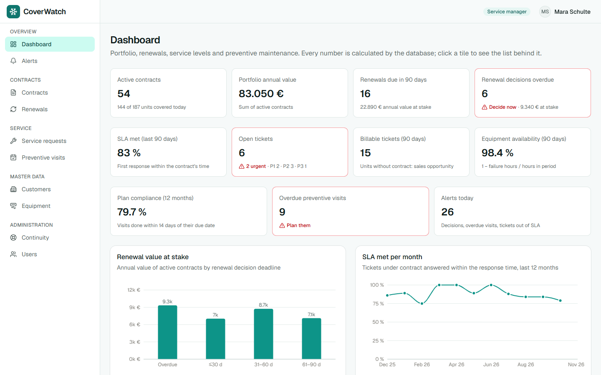
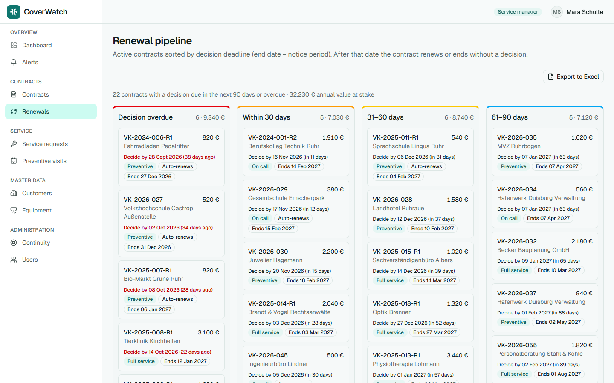
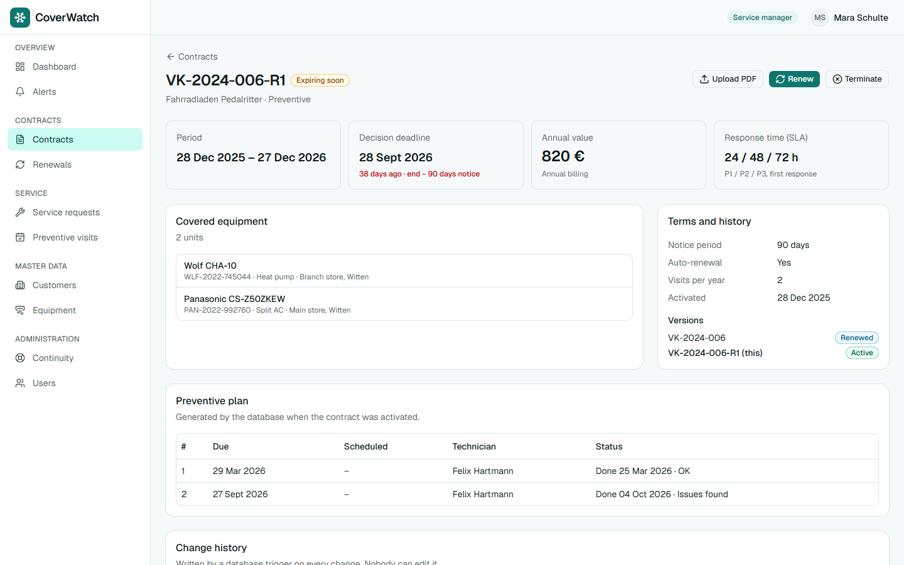
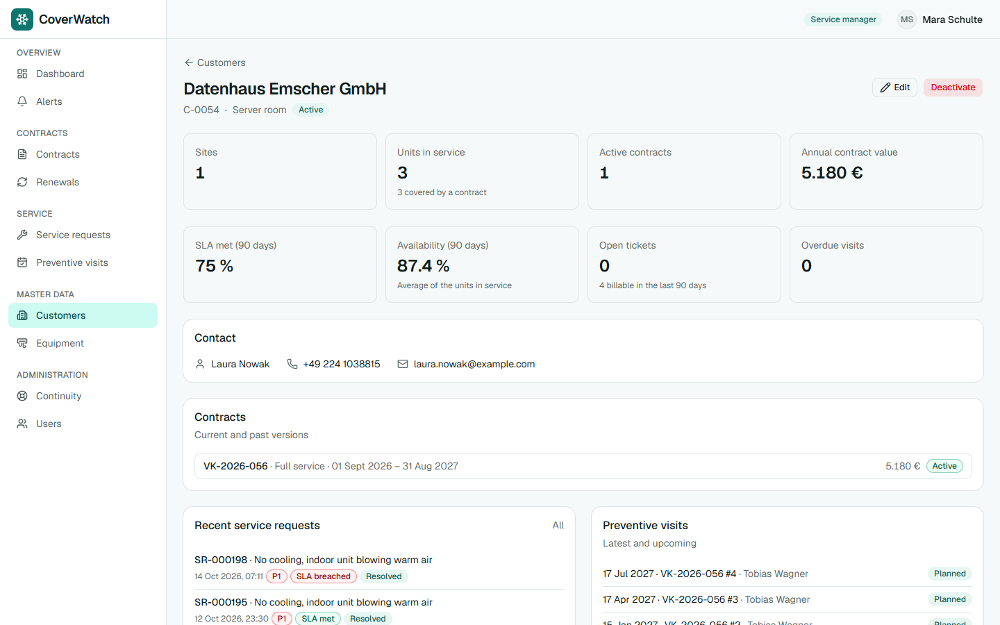
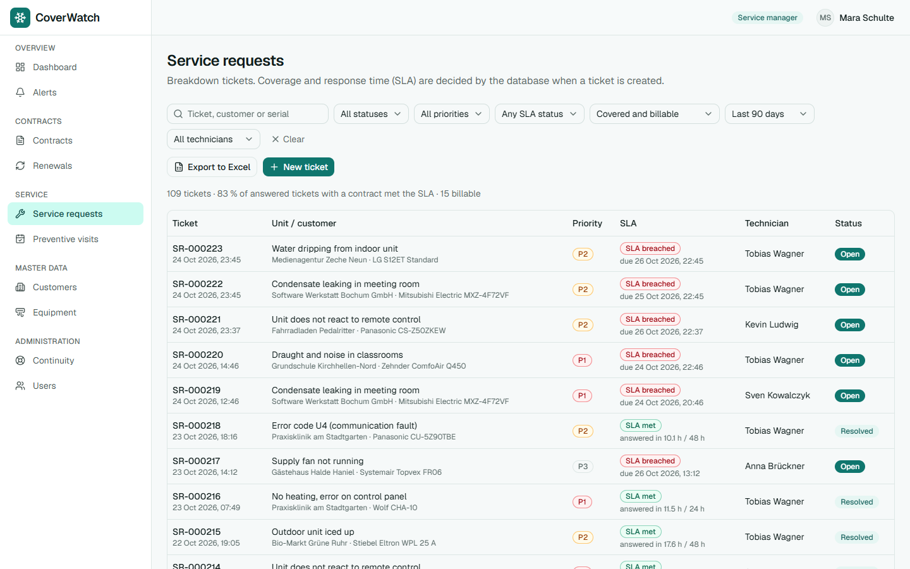
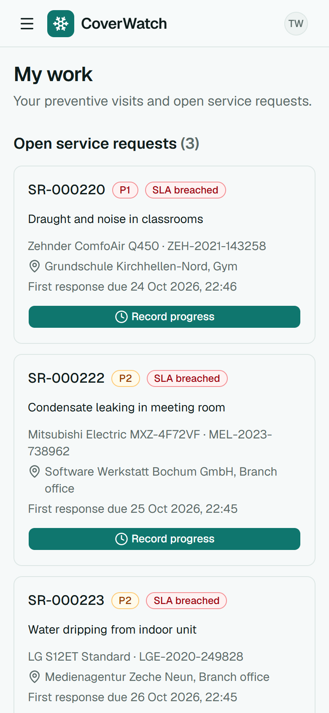
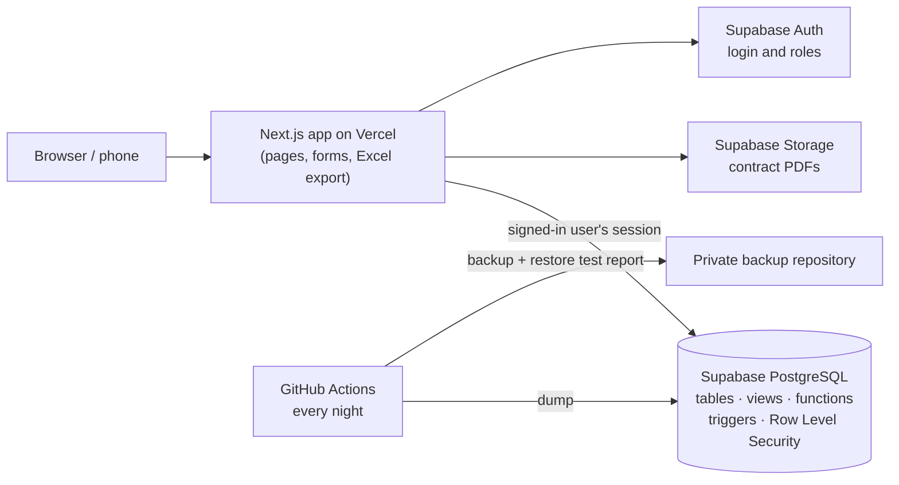
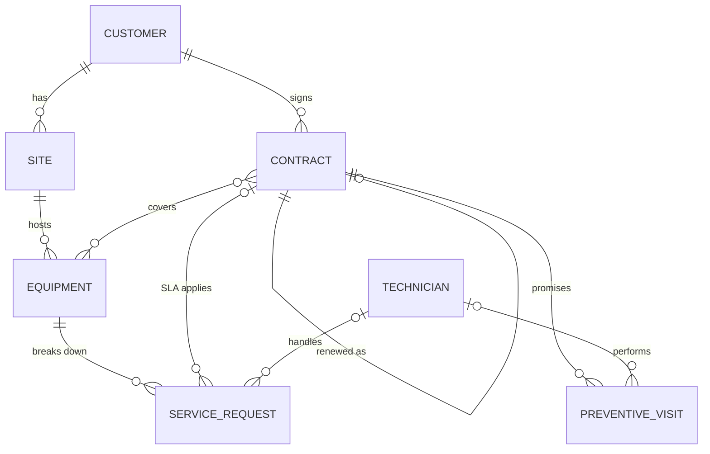

# CoverWatch

**Service contract and maintenance management for a small HVAC service company**: the step between an Excel file and an enterprise service system.

**Live demo: [coverwatch-five.vercel.app](https://coverwatch-five.vercel.app)**: click *Explore the demo* and pick a role. No sign-up needed; the data is synthetic.

| Role | What you will see |
|---|---|
| **Service manager** | Everything: dashboard, contracts, renewals, users. Can activate, renew and terminate contracts. |
| **Coordinator** | Customers, equipment, service requests and visit planning. Reads contracts but cannot change them. |
| **Technician** | Only *My work*: their own visits and tickets, built for the phone. |



## The problem

*Velden Klimatechnik GmbH* (fictional, Ruhr area) installs and services air conditioning, heat pumps and ventilation for about 60 business customers: offices, clinics, hotels, schools and small server rooms. The business lives on **maintenance contracts**: an annual fee in exchange for preventive visits and a guaranteed response time (SLA) when something breaks.

Before CoverWatch, contracts lived in one person's Excel file, PDFs in shared folders and deadlines in that person's Outlook reminders. That meant:

- contracts expiring unnoticed, and notice periods missed, leading to unwanted auto-renewals or lost renewal revenue;
- response times nobody measured, so customer complaints could not be answered with data;
- preventive visits (exactly what the contract promises) late or skipped;
- work done for free on units that were not under contract;
- no view of the portfolio value or upcoming renewals, and no backup if that one person was away.

## What it does

| Area | Highlights |
|---|---|
| **Contracts and renewals** | Lifecycle `DRAFT → ACTIVE → EXPIRED / RENEWED / TERMINATED`. A renewal creates a new version linked to the previous one; nothing is deleted. Signed PDF per contract. |
| **Renewal pipeline** | Active contracts sorted by **decision deadline** (end date − notice period), in overdue / 30 / 60 / 90-day buckets with the value at stake. |
| **Service requests and SLA** | When a ticket is created, the database decides whether the unit was covered at that moment and which response time applies. SLA met = first response within the contract's hours. Tickets on units without a contract are flagged as billable. |
| **Preventive maintenance** | Activating a contract generates the visit plan. Coordinators assign technicians and dates; technicians record the outcome from their phone. |
| **Dashboard and alerts** | Portfolio value, renewals, SLA %, plan compliance, availability, open tickets by priority. Each tile links to the list behind it, and a SQL check proves they match. |
| **Customer 360** | Contracts, equipment with availability, tickets and visits of one customer. |
| **Continuity** | Excel export on every list (with the screen's filters), a full export for non-technical users, a printable week view, an error log, and **nightly backups with an automatic restore test**. |

| Renewal pipeline | Contract with versions and visit plan |
|---|---|
|  |  |

| Customer 360 | Service requests and SLA | Technician on the phone |
|---|---|---|
|  |  |  |

## How it is built



**The business rules live in the database, not in the screens.** The app only shows data and calls database functions; PostgreSQL enforces the rules even if someone bypasses the interface:

- **Constraints:** a unit can never be covered by two binding contracts with overlapping dates (an `EXCLUDE` constraint on date ranges), SLA times must be P1 ≤ P2 ≤ P3, a terminated contract needs a reason.
- **Functions** for actions that change several tables: activate, renew, terminate, and a nightly job that expires contracts or renews them automatically.
- **Triggers** for rules that must never be skipped: coverage and SLA snapshot on every ticket, visit plan on activation, frozen terms once a contract is active, and the **audit log** (who changed what and when).
- **Row Level Security** per role: a technician only sees their own visits and tickets, because the database filters them, not because the menu hides them.
- **Views** calculate every status and KPI, so the dashboard and the lists can never disagree.

### Data model



Full model, rules and views: [docs/DATA_MODEL.md](docs/DATA_MODEL.md).

### KPIs (all calculated in PostgreSQL views)

| KPI | Definition |
|---|---|
| Decision deadline | `end_date − notice_period_days` |
| Expiring soon | Active and decision deadline ≤ today + 90 days |
| SLA met | `first_response_at − reported_at ≤ SLA hours` for the ticket's priority |
| Availability (90 days) | 1 − failure hours / hours in the period |
| Plan compliance | Visits done within 14 days of their due date / visits that were due |
| Portfolio value | Sum of the annual value of active contracts |

## Tech stack

Next.js (App Router, TypeScript) · Tailwind CSS · shadcn/ui · Recharts · Supabase (PostgreSQL, Auth, Storage) · exceljs · GitHub Actions · Vercel. Everything runs on free tiers.

## Quality and verification

- Database changes only as numbered migrations (`supabase/migrations/`), applied with the Supabase CLI.
- SQL test scripts in `supabase/verification/`: 14 constraint checks, 46 business-logic and permission checks run as each role, and 13 checks that every dashboard KPI equals its list.
- Re-runnable demo data (`npm run db:seed`) built through the same database functions the app uses.
- Nightly restore test: the backup is restored into an empty PostgreSQL and every table's row count is compared with production.

## Run it locally

```bash
npm install
cp .env.example .env.local   # add your Supabase URL and publishable key
npx supabase link            # link your Supabase project
npx supabase db push         # create the schema
npm run db:seed              # demo data and demo accounts
npm run dev                  # http://localhost:3000
```

## Documentation

| Document | Contents |
|---|---|
| [docs/PROJECT_BRIEF.md](docs/PROJECT_BRIEF.md) | Scenario, scope, business rules and phases |
| [docs/DATA_MODEL.md](docs/DATA_MODEL.md) | Tables, rules, views and security |
| [docs/DEMO_DATA.md](docs/DEMO_DATA.md) | How the demo data is generated |
| [docs/RUNBOOK.md](docs/RUNBOOK.md) | What to do when something fails; backup and restore |
| [docs/PRODUCTION.md](docs/PRODUCTION.md) | What would change for real use in a company |

## Deliberate simplifications

Fixed annual value per contract (no per-unit pricing or indexation), SLA on first response only (not on resolution), one time zone (Europe/Berlin), synthetic data. Out of scope by design: invoicing, e-signature, e-mail notifications, customer portal, offline mode, ERP integration and spare-parts inventory.
