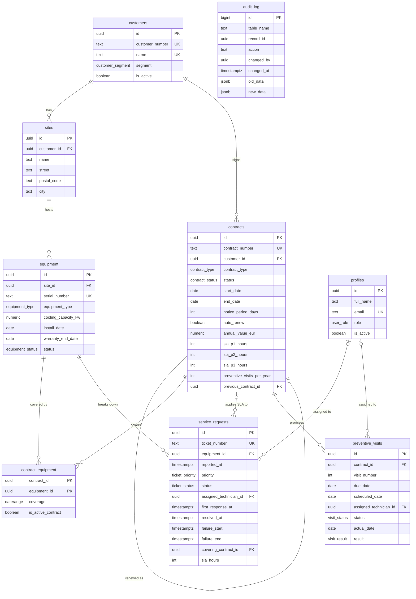

# Data model

CoverWatch stores master data (customers, sites, equipment, users), maintenance contracts and the work done under them (service requests and preventive visits). All rules that must never be broken live in PostgreSQL as constraints.

## Entity-relationship diagram

`audit_log` has no foreign keys on purpose: history must survive even if a referenced row changes.

## Tables

| Table | Purpose |
|---|---|
| `customers` | B2B customers. `customer_number` is generated (C-0001). |
| `sites` | Customer buildings where equipment is installed. |
| `equipment` | Installed units with serial number, type, capacity and warranty. |
| `profiles` | App users linked to Supabase Auth, with their role. Technicians are profiles with `role = technician`. |
| `contracts` | Maintenance contracts. Never deleted: they change status or are renewed as a new row linked through `previous_contract_id`. |
| `contract_equipment` | Which units each contract covers (many-to-many). |
| `service_requests` | Breakdown tickets. `ticket_number` is generated (SR-000001). |
| `preventive_visits` | One row per promised preventive visit of a contract. |
| `audit_log` | Change history for contracts and tickets (filled by triggers in Phase 2). |

## Key rules enforced by the database

| Rule | How |
|---|---|
| A unit cannot be in two ACTIVE contracts with overlapping dates | `EXCLUDE USING gist (equipment_id WITH =, coverage WITH &&) WHERE (is_active_contract)` on `contract_equipment` |
| Contract ends after it starts; notice period shorter than the contract | `CHECK` on `contracts` |
| SLA hours: P1 ≤ P2 ≤ P3 | `CHECK` on `contracts` |
| A terminated contract needs a date and a reason | `CHECK` on `contracts` |
| A contract can be renewed only once (one successor) | `UNIQUE (previous_contract_id)` |
| First response and resolution cannot be before the report | `CHECK` on `service_requests` |
| RESOLVED ⇔ resolution time is set | `CHECK` on `service_requests` |
| A ticket has an SLA only if it is linked to a covering contract | `CHECK` on `service_requests` |
| A visit is DONE ⇔ it has an actual date and a result | `CHECK` on `preventive_visits` |
| Unique serial numbers, contract numbers, customer names | `UNIQUE` |
| German postal codes (5 digits), valid e-mail format | `CHECK` with regular expressions |

### Why `contract_equipment` copies the contract period and status
An `EXCLUDE` constraint can only compare columns of one table. The contract period (`coverage`) and whether the contract is active (`is_active_contract`) are therefore copied onto each link row. Two triggers keep the copy in sync: when a unit is linked, and when a contract's dates or status change. That second trigger means activating a contract re-checks the rule, so a DRAFT can overlap, but it cannot be activated while the unit is still covered elsewhere.

### Calculated, not stored
- "Expiring soon" status, decision deadline (`end_date − notice_period_days`), SLA met / breached, overdue visits, availability and billable tickets are calculated in views (Phase 2), not stored.

## Security
Row Level Security is enabled on every table. Until Phase 2 adds role-based policies, the API returns no rows to anyone.

## Verification
- `supabase/verification/phase1_structure.sql`: tables, columns, constraints, indexes and RLS status.
- `supabase/verification/phase1_checks.sql`: 14 valid and invalid inserts; each must be accepted or rejected as expected. All test data is rolled back.
