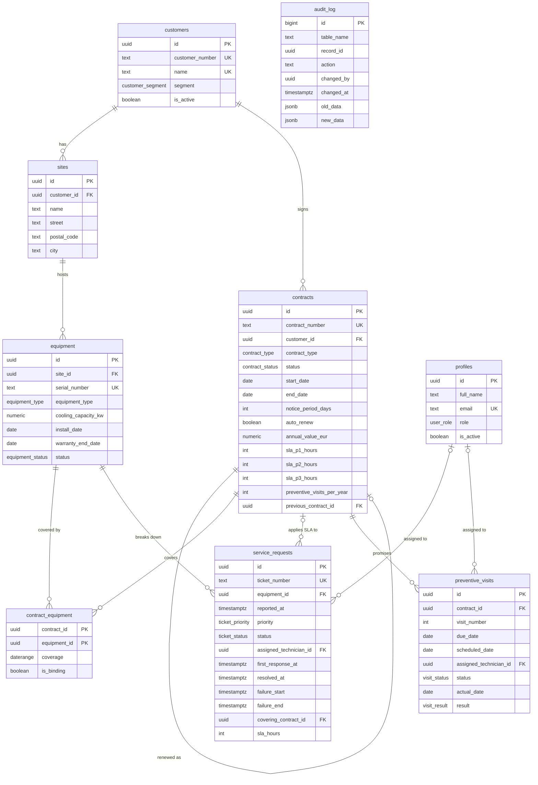

# Data model

CoverWatch stores master data (customers, sites, equipment, users), maintenance contracts and the work done under them (service requests and preventive visits). All rules that must never be broken live in PostgreSQL as constraints.

## Entity-relationship diagram

`audit_log` has no foreign keys on purpose: history must survive even if a referenced row changes.

## Tables

| Table | Purpose |
|---|---|
| `customers` | B2B customers. `customer_number` is generated (C-0001). |
| `sites` | Customer buildings where equipment is installed. |
| `equipment` | Installed units with serial number, type, capacity and warranty. |
| `profiles` | App users linked to Supabase Auth, with their role. Technicians are profiles with `role = technician`. |
| `contracts` | Maintenance contracts. Never deleted: they change status or are renewed as a new row linked through `previous_contract_id`. |
| `contract_equipment` | Which units each contract covers (many-to-many). |
| `service_requests` | Breakdown tickets. `ticket_number` is generated (SR-000001). |
| `preventive_visits` | One row per promised preventive visit of a contract. |
| `audit_log` | Change history for contracts and tickets (filled by triggers in Phase 2). |

## Key rules enforced by the database

| Rule | How |
|---|---|
| A unit cannot be covered by two binding (non-draft) contracts with overlapping dates | `EXCLUDE USING gist (equipment_id WITH =, coverage WITH &&) WHERE (is_binding)` on `contract_equipment` |
| Contract ends after it starts; notice period shorter than the contract | `CHECK` on `contracts` |
| SLA hours: P1 ≤ P2 ≤ P3 | `CHECK` on `contracts` |
| A terminated contract needs a date and a reason | `CHECK` on `contracts` |
| A contract can be renewed only once (one successor) | `UNIQUE (previous_contract_id)` |
| First response and resolution cannot be before the report | `CHECK` on `service_requests` |
| RESOLVED ⇔ resolution time is set | `CHECK` on `service_requests` |
| A ticket has an SLA only if it is linked to a covering contract | `CHECK` on `service_requests` |
| A visit is DONE ⇔ it has an actual date and a result | `CHECK` on `preventive_visits` |
| Unique serial numbers, contract numbers, customer names | `UNIQUE` |
| German postal codes (5 digits), valid e-mail format | `CHECK` with regular expressions |

### Why `contract_equipment` copies the contract period and status
An `EXCLUDE` constraint can only compare columns of one table. The contract period (`coverage`) and whether the contract is binding (`is_binding` = not a draft) are therefore copied onto each link row. Two triggers keep the copy in sync: when a unit is linked, and when a contract's dates, status or termination date change. Activating a contract re-checks the rule, so a DRAFT may overlap, but it cannot be activated while the unit is covered elsewhere. A TERMINATED contract only covers up to its termination date.

## Business logic (Phase 2)

### Contract lifecycle
`DRAFT → ACTIVE → EXPIRED | RENEWED | TERMINATED`. A guard trigger rejects any other change, any delete, and any change to the terms (dates, value, SLA, visits) once a contract is active. Closed contracts only accept notes and the PDF.

| Action (function) | Who | What it does |
|---|---|---|
| `activate_contract(id)` | manager | DRAFT → ACTIVE. Needs at least one unit. A trigger generates the preventive visits, spread evenly over the period (pro-rated for periods that are not one year). |
| `renew_contract(id, number?, value?, months?)` | manager | Creates the next version (`VK-…-R1`, `-R2`…) starting the day after the old end, copies the units still in service, activates it and marks the old one RENEWED. |
| `terminate_contract(id, date, reason)` | manager | ACTIVE → TERMINATED. Coverage ends on that date; later planned visits are cancelled. |
| `expire_contracts()` | daily job (pg_cron, 01:15 UTC) | Contracts past their end date: auto-renewed if `auto_renew`, otherwise EXPIRED. |

### Service requests
When a ticket is created (or its unit, report time or priority change), a trigger looks up the binding contract that covered the unit on the report date and stores it with the SLA hours for that priority. No contract = billable ticket.

### Audit log
Triggers write every insert, update and delete on `contracts` and `service_requests` to `audit_log`: who (`auth.uid()`), when, and the before/after values of only the fields that changed. Nobody can edit or delete the log through the app.

### Calculated in views (not stored)
| View | Contents |
|---|---|
| `v_contracts` | Contracts with decision deadline (`end_date − notice_period_days`), days to decision, `EXPIRING_SOON` display status, previous/next version, unit count |
| `v_renewal_pipeline` | Active contracts with a decision in ≤ 90 days or overdue: buckets OVERDUE, DUE_30, DUE_60, DUE_90 |
| `v_equipment` | Units with site, customer and the contract covering them today |
| `v_service_requests` | Tickets with SLA due time, response hours, SLA status (MET, BREACHED, PENDING, NO_SLA), billable flag |
| `v_preventive_visits` | Visits with planned date, overdue flag, done-on-time flag (≤ 14 days after due date), addresses |
| `v_equipment_availability` | 1 − failure hours / 2,160 h (last 90 days) per unit |
| `v_customer_summary` | Customer 360 KPIs |
| `v_dashboard_kpis` | One row with all dashboard KPIs |
| `v_alerts` | What needs action today: renewal decisions (≤ 30 days or overdue), overdue visits, open tickets out of SLA |
| `v_audit_log` | Audit entries with the name of who made the change |

All views use `security_invoker`, so each user only sees the rows their role allows.

## Security (Row Level Security)
| Role | Read | Write |
|---|---|---|
| manager | everything | everything (contracts and renewals only through the actions above) |
| coordinator | everything except the audit log | customers, sites, equipment, service requests, visit planning |
| technician | master data; only their own visits and tickets (and the contracts behind them) | outcome of their own visits and tickets only (enforced field by field) |
| viewer | everything | nothing |
| anonymous | nothing | nothing |

Nobody deletes through the app: records are deactivated, cancelled, terminated or renewed. New sign-ups get a profile with role `viewer`; a manager promotes them.

## Verification
- `supabase/verification/phase1_structure.sql`: tables, columns, constraints, indexes and RLS status.
- `supabase/verification/phase1_checks.sql`: 14 valid and invalid inserts; each must be accepted or rejected as expected.
- `supabase/verification/phase2_checks.sql`: 42 checks of the lifecycle, coverage/SLA, availability, audit log and permissions, each run as the corresponding role (manager, coordinator, two technicians, viewer, anonymous).

All verification scripts roll back their test data.
